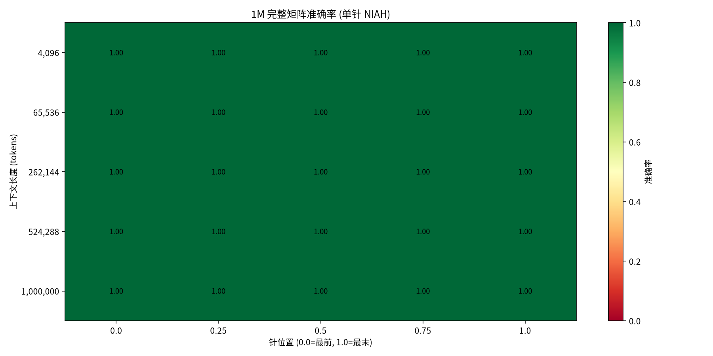
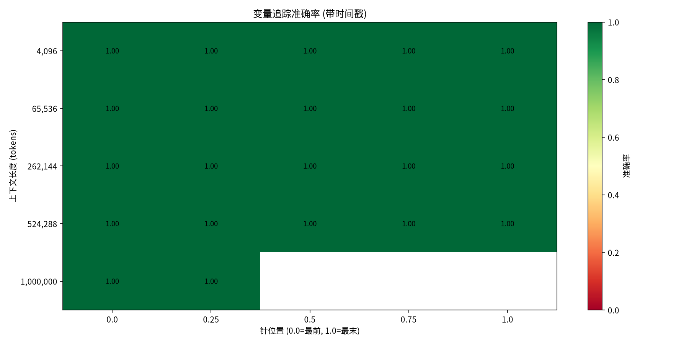
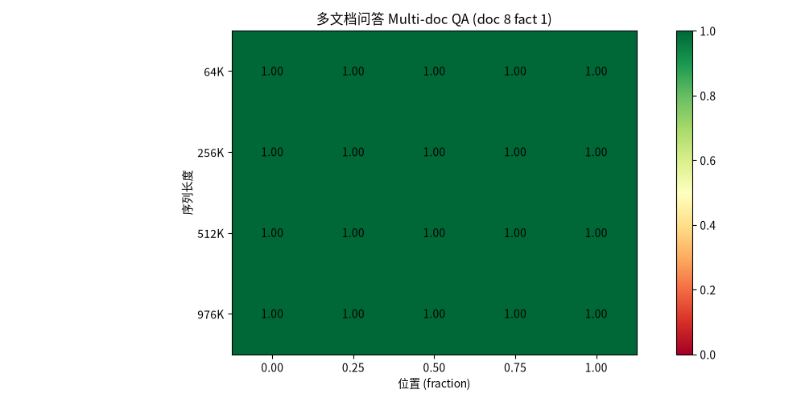
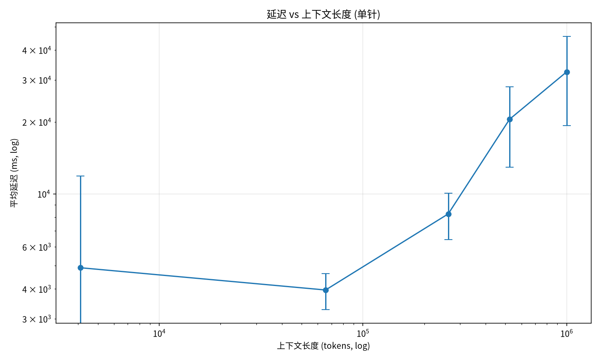

# Effective Context Lab — 长上下文有效利用率测量仪

[](https://github.com/aidless/effective-context-lab/actions/workflows/ci.yml)

> **English TL;DR**: A measurement lab for the gap between a model's claimed and actually effective context window, using reproducible NIAH probes covering six RULER-style tasks (single/multi-needle retrieval, multi-choice, variable tracking, aggregation, multi-doc QA) against OpenAI-compatible endpoints. Run `python3 scripts/run_benchmark.py`; 44 tests cover probes, scoring, and the runner. On the one model measured (deepseek-v4.1-flash, claimed 1M), all six tasks were fully correct within 1M and no decay was observed — a single-model boundary.

> 实测「模型声称的上下文窗口」与「实际有效窗口」的差距，用可复现的 NIAH（Needle In A Haystack）探针。

## 背景：为什么需要这个

长上下文模型的**声称窗口 ≠ 有效窗口**。RULER v1（arXiv:2404.06654）显示：声称 ≥32K 的模型中，仅约一半真正达到。RULER v2（2026 复现表，Qwen3-235B）进一步给出量化衰减：8K 时 87.3% → 1M 时 36.1%。「窗口大」不等于「窗口能用」。

> 引用边界：arXiv:2404.06654 是 RULER **v1**（2024-04，评测 17 个模型），其中不含 Qwen3-235B；上句后半段的 87.3%→36.1% 来自 RULER **v2** 的复现表（见 `reports/FINAL-REPORT.md` 与 `reports/LITERATURE-REVIEW.md`）。v2 的 arXiv ID 本仓未收录，故此处不附编号。

本测量仪用 Magpie 网关的真实 1M 模型做实测，回答：**在声称 1M 窗口内，模型到底在什么位置、什么长度下仍然有效？**

## 核心结论（2026-11-01 实测）

**`opencode-go/deepseek-v4.1-flash`（声称 1M 窗口）在 1M 内对检索型和追踪型任务全部正确。**

| 任务 | 复杂度 | 1M 内表现 | 正确数 | 数据载体 |
|------|-------|----------|--------|----------|
| 单针 NIAH | 检索（最简单） | 全部正确 | 50/50 cases（25 cells × repeats=2） | `data/1m-full-matrix-*.json` |
| 多针检索（2 针） | 检索 | 全部正确 | 20/20 | `data/multi-needle-2-*.json` |
| 多项选择 | 检索+选择 | 全部正确 | 25/25 | `data/multi-choice-*.json` |
| 变量追踪（带时间戳） | 跨上下文追踪推理 | 全部正确 | 25/25 | `data/variable-tracking-*.json` + `data/variable-tracking-1m-*.json` |
| 聚合（Aggregation） | 跨上下文求和 | 全部正确 | 20/20 | `data/aggregation-*.json` |
| 多文档问答（Multi-doc QA） | 跨文档定位 | 全部正确 | 20/20 | `data/multi-doc-qa-*.json` |

> 「cells」= (seq_len × position) 的网格点；「cases」= 网格点 × repeats。
> 单针 1M 完整矩阵是 **25 cells / 50 cases**；其余任务是每点 1 次，即 rows 数 = cases 数。

> **全部 6 类 RULER 任务（含跨上下文推理的聚合/多文档问答）在 1M 内全部正确**——尚未观察到有效窗口衰减。真正的瓶颈可能出现在 >1M 长度、更高信息密度或更复杂的推理任务上。

## 结果可视化

以下各图均由 `scripts/plot_results.py` 从 `data/*.json` 原始 cells 生成（汇总全对，
热力图上所有格子都是 1.0——这正是「1M 内无衰减」的直观形态）：



| | |
|---|---|
|  |  |
|  |  |
|  |  |

> `reports/figures/` 内共 7 张已提交的图。`plot_results.py` 当前有 4 个热力图分支 +
> 延迟曲线（共 5 张）；聚合与多文档问答两张热力图由同一份数据生成、已随仓库提交，
> 脚本里的对应生成分支尚未合入（重跑 `plot_results.py` 不会覆盖这两张）。

## 安装与使用

### 依赖

```bash
pip install matplotlib numpy pytest
```

> `effective_context_lab` 包本身只用 Python 标准库（`urllib.request` 走 OpenAI 兼容协议）；
> `matplotlib` / `numpy` 只有 `scripts/plot_results.py` 需要，`pytest` 只有跑测试需要。
> 另有可选的本地模型后端用 `numpy`（`clients.py` 的 `MockClient`）。

### 跑 benchmark

```bash
python3 scripts/run_benchmark.py \
  --model opencode-go/deepseek-v4.1-flash \
  --base-url http://127.0.0.1:3425/v1 \
  --seq-lens 4096 65536 262144 524288 1000000 \
  --positions 0.0 0.25 0.5 0.75 1.0 \
  --repeats 2 \
  --seed 7 \
  --max-tokens 300
```

> `--seq-lens` / `--positions` 是 `nargs="+"`，**必须空格分隔**；写成逗号分隔会直接
> `invalid int value: '4096,65536,...'` 退出 2。
> `--base-url` 默认指向本机 Magpie 网关（`127.0.0.1:3425`）；换一个 OpenAI 兼容端点即可。
> 客户端不带鉴权头（`api_key` 默认为空）；若端点需要 key，目前只能改 `clients.py` 的默认值
> —— 本仓**没有** `--api-key` 开关，也没有读环境变量的路径。

输出：`data/*.json`（原始 cells）+ 报告。

### 跑测试

```bash
python3 -m pytest tests/ -q
```

**44 项测试全绿**（RED→GREEN 纪律：每条断言先注入违规验证能红，再验证合规通过）。
分文件：test_clients 5 + test_probes 20 + test_runner 6 + test_scoring 13 = 44。

### 可视化

```bash
python3 scripts/plot_results.py
```

输出：`reports/figures/*.png`（准确率热力图 + 延迟曲线）。当前脚本生成 5 张：
`heatmap-1m` / `heatmap-multineedle` / `heatmap-multichoice` / `heatmap-variable-tracking` / `latency`；
聚合与多文档问答的热力图脚本里暂无对应分支，但两张图已从同一份数据生成并随仓库提交
（见上方「结果可视化」，共 7 张图在 `reports/figures/`）。

## 项目结构

```
effective-context-lab/
├── effective_context_lab/
│   ├── probes.py      # NIAH 探针生成器 (单针/多针/多项选择/变量追踪/聚合/多文档)
│   ├── scoring.py     # 评分 (exact_match/f1/multi_choice)
│   ├── clients.py     # 模型客户端 (OpenAICompat/Mock + complete_full)
│   └── runner.py      # benchmark 运行器 (run_probe/run_benchmark)
├── scripts/
│   ├── run_benchmark.py   # CLI 入口
│   └── plot_results.py    # 可视化
├── tests/             # 44 项测试
├── data/              # 原始 cells (JSON)
└── reports/
    ├── FINAL-REPORT.md   # 最终报告
    └── figures/           # 生成图
```

## 关键技术决策

### 1. token 膨胀率校正

探针生成时用空白切分估长度，但真实 tokenizer 分词更多（膨胀率 1.26）。**生成时目标 = seq_len / 1.26**，使实际 `prompt_tokens ≈ seq_len`（单针 1M 探针实际 996,354，误差 0.365%；各任务 max prompt_tokens 略有差异：multi-needle-2 996,353 / multi-choice 996,354 / aggregation 996,364 / variable-tracking 996,419 / multi-doc-qa 996,506）。

### 2. 真实上下文长度以 `prompt_tokens` 为准

`actual_len`（空白切分）是错误口径。正确口径 = `prompt_tokens`（单针 1M 探针真实 996,354，占声称 99.635%）。实现：`complete_full()` 从 usage 读取。

### 3. reasoning 模型需要足够 `max_tokens`

`max_tokens=32` 会让 reasoning 模型的输出全被 reasoning 占满 → content 为空 → **伪影 0 分**。修正为 `max_tokens=300` 后数据真实可靠。

### 4. 有效窗口定义

某位置下最大 seq_len 满足 `avg accuracy ≥ 0.856`（RULER 阈值）。

## 数据文件清单

| 文件 | 内容 |
|------|------|
| `data/1m-full-matrix-*.json` | 单针 1M 完整矩阵（25 cells / 50 cases） |
| `data/multi-needle-2-*.json` | 多针检索（20 cells） |
| `data/multi-choice-*.json` | 多项选择（25 cells） |
| `data/variable-tracking-*.json` | 变量追踪（25 cells） |
| `data/aggregation-*.json` | 聚合（20 cells） |
| `data/multi-doc-qa-*.json` | 多文档问答（20 cells） |

## 已知限制

- **测量对象单一**：仅 `opencode-go/deepseek-v4.1-flash`（Magpie 网关）。GLM-5.3 数据不可靠（服务端限流），未纳入主对比。
- **配额限制**：OpenCode Go 每日配额用尽会返回 429（错误消息 `Go usage limit exceeded`），需等待 22:32 UTC-8 恢复。
- **任务覆盖**：6 类 RULER 任务已全部测量（单针/多针/多项选择/变量追踪/聚合/多文档问答），1M 内全部正确。
- **文献对比**：本测量与 RULER/∞Bench/BABILong/LongBench 系列同类，但用 Magpie 网关测 DeepSeek v4.1 flash（非开源模型权重），1M 内 6 类任务全对，RULER 原论文「几乎所有模型随长度大幅下降」的结论在本测量中未复现。

## 复现

所有数字来自 `data/*.json` 原始 cells，可重算。报告：`reports/FINAL-REPORT.md`。

逐文件对应的生成命令（参数取自各文件 `config` / `results` 块，与仓内产物一致）：

```bash
# 单针 1M 完整矩阵 → data/1m-full-matrix-*.json（25 cells × repeats=2 = 50 cases）
python3 scripts/run_benchmark.py --task single_needle \
  --seq-lens 4096 65536 262144 524288 1000000 \
  --positions 0.0 0.25 0.5 0.75 1.0 --repeats 2 --seed 7 --max-tokens 300

# 多针 / 多项选择 / 变量追踪 / 聚合 / 多文档（每点 1 次）
python3 scripts/run_benchmark.py --task multi_needle   --seq-lens 65536 262144 524288 1000000 --positions 0.0 0.25 0.5 0.75 1.0 --repeats 1 --max-tokens 300
python3 scripts/run_benchmark.py --task multi_choice   --seq-lens 4096 65536 262144 524288 1000000 --positions 0.0 0.25 0.5 0.75 1.0 --repeats 1 --max-tokens 300
python3 scripts/run_benchmark.py --task variable_tracking --seq-lens 4096 65536 262144 524288 1000000 --positions 0.0 0.25 0.5 0.75 1.0 --repeats 1 --max-tokens 300
python3 scripts/run_benchmark.py --task aggregation     --seq-lens 65536 262144 524288 1000000 --positions 0.0 0.25 0.5 0.75 1.0 --repeats 1 --max-tokens 300
python3 scripts/run_benchmark.py --task multi_doc_qa    --seq-lens 65536 262144 524288 1000000 --positions 0.0 0.25 0.5 0.75 1.0 --repeats 1 --max-tokens 300
```

> 各次运行的**输出文件名带时间戳**，不会覆盖既有产物；重跑后请与 `data/` 中同名旧文件比对。
> `data/` 下另有 4 个**失败或被取代**的 run（`final-benchmark-20261101-175003.json`、
> `fine-position-benchmark-*.json`、`glm53-benchmark-*.json`，
> `opencode-go-*-benchmark-*.json`），`min accuracy` 分别为 0.0 / 0.0 / 0.0 / 0.5，
> 对应 README「已知限制」里讲的 `max_tokens=32` 伪影、GLM 限流放弃等情形——
> 它们不是最终结果，引用时不要混用。


---

## 开源许可

本项目以 [MIT License](LICENSE) 开源。

**论文**：`paper/main.md` 包含完整方法、结果与讨论（含 10 篇参考文献），已编译为 `paper/main.pdf`。

**数据**：`data/` 下 13 个 JSON 全部为实测数据（含 4 个失败/被取代的 run，见上文「复现」一节的区分）。逐文件的生成命令见上文「复现」一节。

**Zotero 文献库**：10 篇长上下文基准论文已入库（collection「长上下文基准文献」），详见 `reports/LITERATURE-REVIEW.md`。

## 验收标准与复算

**判据**：本仓判为合格的条件是 `python3 eval/run_cases.py` 通过率必须为 100%（20/20），且 `make eval` 退出码必须为 0；任何一条失败即判为不合格。

### 题库 `eval/cases.jsonl`（20 条七键题库）

每条 case 带 `id/axis/question/expected/mode/verify/source` 七键；`mode=expr|raises|doc`。
`expr`/`raises` 的 `verify` 是真调用本仓 API 或真解析本仓 `data/*.json` 的代码，`expected` 是**现算**出来的值（不是抄文档），改一行实现就会变红。

| axis | 条数 | 覆盖对象 | 来源 |
|------|------|----------|------|
| `scoring/exact` | 2 | 归一化后的精确匹配（大小写/标点、实体多余） | `effective_context_lab/scoring.py:24` |
| `scoring/f1` | 2 | token 级 F1（部分召回、空预测） | `effective_context_lab/scoring.py:29` |
| `scoring/normalize` | 1 | `_normalize` 小写 + 去标点 + 合并空白 | `effective_context_lab/scoring.py:15` |
| `scoring/multi` | 1 | 多项选择命中判定 | `effective_context_lab/scoring.py:53` |
| `scoring/raises` | 1 | 未知评分方法 `is_correct(..., "bleu")` 必须抛 `ValueError` | `effective_context_lab/scoring.py:72` |
| `probes/position` | 3 | 针位置映射、末位夹紧、越界拒绝 | `effective_context_lab/probes.py:90` |
| `probes/tokenizer` | 1 | 1.26 token 膨胀率校正 | `effective_context_lab/probes.py:82` |
| `probes/needle` | 2 | 单针实际长度、多针条数 | `effective_context_lab/probes.py:115` |
| `probes/tasks` | 2 | 变量追踪期望值、聚合求和期望值 | `effective_context_lab/probes.py:306` |
| `runner/cells` | 2 | 有效窗口（阈值 0.856）、effective/claimed 比值 | `effective_context_lab/runner.py:85` |
| `runner/bench` | 1 | `run_benchmark` 端到端单格（MockClient） | `effective_context_lab/runner.py:195` |
| `data/matrix` | 1 | `data/1m-full-matrix-*.json` 的 `n_cases` 总和 | `data/1m-full-matrix-20261101-185523.json` |
| `data/results` | 1 | `data/variable-tracking-1m-*.json` 首条 `prompt_tokens` | `data/variable-tracking-1m-20261101-215955.json` |

### 三条命令

```bash
python3 eval/run_cases.py            # 逐条跑题库，末行必须是 20/20 cases passed（退出码 0）
python3 eval/run_cases.py --selftest # 反证：把 EC-01 的期望改成不可能值，必须变红（19/20，退出码 0）
make eval                            # 一键重跑：题库 + 既有 44 项 pytest，退出码必须为 0
```

`--selftest` 变红是**期望行为**：它证明这套题库不是装饰（对应 AGENTS.md 第 8/21/37 条），因此它自身仍以 0 退出。

### 复算

- 每题的 `verify` 字段**就是**复算代码：`python3 eval/run_cases.py --json` 可看到逐条 `detail`（实算值）。
- `python3 eval/run_cases.py --save` 重建 `eval/run-report.json`（含 `total/passed/failed/failed_by_axis/results`），与仓库内已提交的那份逐字段可比：`total` 必须为 20、`passed` 必须为 20、`failed_by_axis` 必须为空对象。
- 数据类两题（`data/matrix`、`data/results`）直接读 `data/*.json`，重算不依赖任何手抄数字；README「核心结论」里的 50/20/25/20 等计数即由同一批文件得出。
- 题目本身不联网、不调模型：全部为本地纯计算，单次全跑 < 1 s。

### 失败归因

`run_cases.py` 失败时**不只报一个 pass_rate**，而是按 `axis` 汇总失败 id（这是本仓的失败分类口径：axis 即失败类型——评分器、探针、运行器、数据产物四类）：

```
[FAIL] EC-15 probes/tasks: 305
[FAIL] EC-18 runner/bench: raised AttributeError: ...
[FAIL] EC-20 data/results: 未命中

18/20 cases passed
失败归因（按 axis）：
  probes/tasks: 1 条 —— EC-15
  runner/bench: 1 条 —— EC-18
  data/results: 1 条 —— EC-20
```

按 axis 的处置路径：`scoring/*` 失败 → 评分口径变了；`probes/*` 失败 → 探针生成或位置/长度口径变了；`runner/*` 失败 → 有效窗口/链路行为变了；`data/*` 失败 → 落盘产物被替换或改写。
